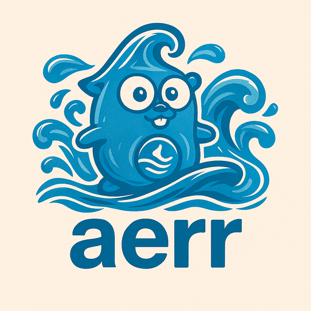

<div align="center">




**Lightweight error handling with structured logging and stack trace support for Go**

</div>

<div align="center">

[](https://github.com/tafaquh/aerr/actions/workflows/ci.yml)
[](https://pkg.go.dev/github.com/tafaquh/aerr)
[](https://goreportcard.com/report/github.com/tafaquh/aerr)
[](https://go.dev/dl/)
[](https://github.com/tafaquh/aerr/blob/main/LICENSE)

</div>

---

`aerr` is a structured-error library for Go. It carries an error **code**, a combined **message**, ordered key/value **attributes**, and an optional **stack trace** in a single value. You structure those fields once, at creation; the resulting error then logs through slog, zerolog, and zap, marshals with `json.Marshal`, and prints with `%+v` — all from the same value, with no per-sink re-assembly.

```go
err := aerr.Code("DB_ERROR").
    Message("failed to query user").
    StackTrace().
    With("user_id", "123").
    With("table", "users").
    Err(errors.New("connection timeout"))

slog.Error("operation failed", slog.Any("err", err))
```

```json
{
  "time": "2026-07-02T14:18:02Z",
  "level": "ERROR",
  "msg": "operation failed",
  "err": {
    "message": "failed to query user: connection timeout",
    "code": "DB_ERROR",
    "attributes": {
      "user_id": "123",
      "table": "users"
    },
    "stacktrace": [
      "/app/main.go:19 (main.main)"
    ]
  }
}
```

> Named for *air* — water, in Indonesian. Like water carrying life on its way downstream, an error should carry the context it collects along its journey — code, message, attributes, and stack — arriving intact where it is finally handled.

## Table of contents

- [Why aerr](#why-aerr)
- [Installation](#installation)
- [Quick start](#quick-start)
- [Core concepts](#core-concepts)
- [Logging integrations](#logging-integrations)
- [Output formats](#output-formats)
- [Redacting sensitive attributes](#redacting-sensitive-attributes)
- [Aggregating errors](#aggregating-errors)
- [API reference](#api-reference)
- [Complete example](#complete-example)
- [Performance](#performance)
- [Compatibility](#compatibility)
- [Versioning and releases](#versioning-and-releases)
- [License](#license)

## Why aerr

- **One value, every sink.** A single `*Error` implements `slog.LogValuer`, `json.Marshaler`, and `fmt.Formatter`, so it logs through slog/zerolog/zap, marshals to JSON, and prints with `%+v` — no adapters glued on at each call site.
- **Structured, not stringly-typed.** An error code, a combined message, ordered attributes, and an optional stack trace live in one value. Stack traces are emitted as structured data, never opaque strings.
- **Flat output from deep chains.** Wrapping flattens the chain into a single record: one code, one combined message, merged attributes, one stack — far easier to read than a nested chain, and produced by deterministic merge rules.
- **Opt-in stack traces.** Capture is off by default and enabled per error with `StackTrace()`, so you pay for it only where you want it. Frames are editor-clickable `file:line (function)` lines with stdlib noise filtered out.
- **Fast by construction.** Fields are structured once at creation, so repeated logging of the same error amortizes to zero allocations with the zerolog adapter.
- **Standard-library compatible.** Works with `errors.Is`, `errors.As`, and `errors.Unwrap`, including `errors.Join` trees.
- **Small dependency surface.** The core module uses only the standard library; the zerolog and zap adapters are separate modules with their own dependencies.

## Installation

```bash
go get github.com/tafaquh/aerr
```

Optional logging adapters (separate modules):

```bash
go get github.com/tafaquh/aerr/zerolog
go get github.com/tafaquh/aerr/zap
```

## Quick start

slog is in the standard library and needs no adapter — `*Error` implements `slog.LogValuer`, so `slog.Any` structures it automatically:

```go
package main

import (
    "errors"
    "log/slog"
    "os"

    "github.com/tafaquh/aerr"
)

func main() {
    slog.SetDefault(slog.New(slog.NewJSONHandler(os.Stdout, nil)))

    err := aerr.Code("DB_ERROR").
        Message("failed to query user").
        StackTrace().
        With("user_id", "123").
        With("table", "users").
        Err(errors.New("connection timeout"))

    slog.Error("operation failed", slog.Any("err", err))
}
```

It prints the record shown at the top of this page, with keys in the order `message`, `code`, `attributes`, `stacktrace`.

## Core concepts

### The builder

Errors are assembled with a fluent builder and finalized into an immutable value. Start a chain with `Code`, `Message`, `Messagef`, or `StackTrace`, attach attributes with `With`, and finalize:

```go
err := aerr.Code("USER_NOT_FOUND").
    Message("failed to find user").
    StackTrace().
    With("user_id", userID).
    With("query", query).
    Err(dbErr)
```

You can start from either end — a code or a message:

```go
// Start with a code
err := aerr.Code("VALIDATION_ERROR").
    Message("invalid email format").
    With("email", email).
    Err(nil)

// Or start with a message
err := aerr.Message("database query failed").
    Code("DB_ERROR").
    With("query", sql).
    Err(dbErr)
```

**Finalizers.** A builder finalizes with one of three methods:

- `Err(cause error)` — records `cause` as the underlying error (pass `nil` for no cause).
- `Wrap(err error)` — wraps another error, returning `nil` when `err` is `nil`.
- `ErrMsg(msg string)` — uses a plain string as the cause (`ErrMsg("")` is equivalent to `Err(nil)`).

Printf-style shortcuts skip the builder entirely: `aerr.Errorf("bad id %d", id)`, `aerr.Wrapf(cause, "op %s failed", op)`, and `aerr.Messagef("retry %d/%d", n, max).Code("X").Err(cause)`.

**Template reuse.** Finalizing **copies** the builder's state into the issued error, so a builder can be kept and reused as a template for further errors.

**Concurrency.** A `*Builder` is not safe for concurrent use (reuse it as a template from a single goroutine). The issued `*Error` is immutable and safe to share and log from multiple goroutines — its stack trace is rendered lazily and cached race-free.

### Wrapping and chain merging

When you wrap errors, they merge into a **single flat structure**:

```go
// Layer 1: database
dbErr := aerr.Code("DB_ERROR").
    Message("database query failed").
    StackTrace().
    With("query", "SELECT * FROM users").
    Err(errors.New("connection timeout"))

// Layer 2: repository wraps the database error
repoErr := aerr.Code("REPOSITORY_ERROR").
    Message("failed to find user in repository").
    With("user_id", "12345").
    Wrap(dbErr)

// Layer 3: service wraps the repository error
serviceErr := aerr.Code("SERVICE_ERROR").
    Message("user service failed").
    With("operation", "GetUser").
    Wrap(repoErr)

slog.Error("request failed", slog.Any("err", serviceErr))
```

The merge rules are deterministic:

- **Single code** — the outermost code wins; an inner code is inherited only when the outer builder set none.
- **Combined message** — the outer message and the full cause message are joined with `": "`, so it reads outermost-first (`user service failed: failed to find user in repository: database query failed: connection timeout`).
- **Merged attributes** — outer attributes win; inner attributes are appended when their key is not already present, preserving order.
- **Deepest stacktrace** — the trace from the origin is kept (see below).
- **Works through `%w`** — metadata (code, attributes, stack) is absorbed from the nearest inner `*Error` in the chain **even behind non-aerr wrappers** such as `fmt.Errorf("...: %w", inner)`.

### Stack traces

Stack capture is **opt-in**: an error captures a trace only when `StackTrace()` is called on its builder.

```go
// With a stack trace
err := aerr.Code("ERR001").
    Message("something failed").
    StackTrace().
    Err(cause)

// Without (do not call StackTrace())
err := aerr.Code("ERR002").
    Message("validation failed").
    Err(nil)
```

**The deepest stack wins.** For both `Err` and `Wrap`: when the wrapped chain already carries a trace, it is inherited and an outer `StackTrace()` becomes a no-op. Each chain therefore captures at most once, and the trace always points at where the error originated. Captured stacks are capped at **32 frames**.

**Clickable format.** Traces render as `file:line (function)` — the leading `file:line` makes each entry clickable in most editors and terminals:

```json
"stacktrace": [
  "/app/repository/user.go:75 (github.com/acme/app/repository.(*UserRepo).Find)",
  "/app/service/user.go:52 (github.com/acme/app/service.(*UserService).Get)",
  "/app/main.go:26 (main.main)"
]
```

**Frame filtering.** You only see your own code. Filtered out:

- **The Go standard library**, matched by source-file path (so `runtime`, `testing`, `net/http`, `encoding/json`, and friends never appear).
- **aerr's own internals.**

User code is **always** kept, regardless of how its module path is spelled — locally-developed modules with slashless (`main`, `myapp`) paths are included, not mistaken for stdlib.

## Logging integrations

The same `*Error` value drives every logger below. Pick the one your codebase already uses; nothing about how you build errors changes.

| Logger | Module | One-time setup | Hot path |
|--------|--------|----------------|----------|
| **slog** | none (standard library) | none | structured automatically via `slog.LogValuer` |
| **zerolog** | `github.com/tafaquh/aerr/zerolog` | `Register()` once in `main` (optional) | zero allocations on repeated logging |
| **zap** | `github.com/tafaquh/aerr/zap` | none | field constructor, drop-in for `zap.Error` |

Whichever logger you use, nothing is silently dropped: `message` is the full text of the error you log, and an aggregate lists its members under `errors`, with any past the cap counted rather than lost (see [Aggregating errors](#aggregating-errors)). The zerolog and zap adapters find the aerr payload anywhere in an error's chain — an aggregate with no aerr error in it is left to the logger's own rendering — while slog structures only the value you hand it, so there you should wrap with aerr rather than `fmt.Errorf` (see below).

### slog (standard library)

No module and no setup: `*Error` implements `slog.LogValuer`, so any `slog.Any("err", err)` structures the whole payload. See [Quick start](#quick-start) for a full program; the essential call is:

```go
slog.Error("operation failed", slog.Any("err", err))
```

Keys emit in the order `message`, `code`, `attributes`, `stacktrace` (each only when set), followed by `errors` when the error wraps an aggregate. slog has no array kind for groups, so there `errors` is a group keyed by position (`"0"`, `"1"`, …): every member value goes through the handler like any other attribute, so `ReplaceAttr` and `slog.LogValuer` types reach it.

> **Keep the payload visible: wrap with aerr, not `fmt.Errorf`.** slog structures the value you hand it, and only an aerr value carries a `LogValue`. An `*aerr.Error` behind a plain wrapper — `fmt.Errorf("handler: %w", err)` — is just an `error` to slog, so it logs as its message string with the code, attributes, and stack trace invisible. Wrap with `aerr.Wrapf(err, "handler")` (or a builder's `Wrap`) instead: the result reads the same, `handler: …`, and is still an `*aerr.Error` carrying the full payload.

When the wrapping is out of your hands — middleware or a library adds `fmt.Errorf` layers — one `ReplaceAttr` hook restores the payload at log time. slog resolves `LogValuer`s before calling the hook, so it only ever sees errors that are not aerr values themselves, and `aerr.Wrapf(err, "")` turns the ones carrying an aerr error into an `*aerr.Error` with the same message:

```go
slog.New(slog.NewJSONHandler(os.Stdout, &slog.HandlerOptions{
    ReplaceAttr: func(_ []string, a slog.Attr) slog.Attr {
        if err, ok := a.Value.Any().(error); ok {
            if _, found := aerr.AsAerr(err); found {
                return slog.Any(a.Key, aerr.Wrapf(err, ""))
            }
        }
        return a
    },
}))
```

### zerolog

```bash
go get github.com/tafaquh/aerr/zerolog
```

> **Note:** the `v1.0.0` tag of this module is **retracted** — it did not compile standalone — so `go get` skips it and resolves the latest working release.

Neither usage below requires calling `.Stack()`: an aerr error's trace is always rendered inside the error object, so `.Stack()` is unnecessary and would only duplicate it.

**Register once (process-wide).** `Register()` assigns `zerolog.ErrorMarshalFunc`, chaining to whatever marshaler was active before it, so non-aerr errors keep their previous rendering. Call it once from `main`, not from library code. After that, the standard zerolog API renders aerr errors in full. Note that `.Err(err)` writes under zerolog's default error key, `"error"`.

```go
package main

import (
    "errors"
    "os"

    "github.com/rs/zerolog"
    "github.com/tafaquh/aerr"
    aerrzerolog "github.com/tafaquh/aerr/zerolog"
)

func main() {
    aerrzerolog.Register() // once, from main

    logger := zerolog.New(os.Stdout).With().Timestamp().Logger()

    err := aerr.Code("DB_ERROR").
        Message("query failed").
        StackTrace().
        With("user_id", "123").
        Err(errors.New("connection timeout"))

    // Standard zerolog API — renders under the "error" key.
    logger.Error().Err(err).Msg("operation failed")
}
```

Keys appear as `code` then `message`:

```json
{
  "level": "error",
  "error": {
    "code": "DB_ERROR",
    "message": "query failed: connection timeout",
    "attributes": {
      "user_id": "123"
    },
    "stacktrace": [
      "/app/main.go:18 (main.main)"
    ]
  },
  "time": "2026-07-05T14:18:02+07:00",
  "message": "operation failed"
}
```

**Zero globals (per call).** Render a single error explicitly with `Object`, choosing your own key — no package state is touched:

```go
logger.Error().Object("err", aerrzerolog.Object(err)).Msg("operation failed")
```

### zap

```bash
go get github.com/tafaquh/aerr/zap
```

zap has no process-global error marshaler to register, so the integration is a **field constructor** — no globals, fully idiomatic zap.

**Drop-in field.** `Field(err)` renders under the key `"error"`: a nested object (code, message, attributes, stacktrace) when the chain carries an `*aerr.Error`, `zap.Error` otherwise, and `zap.Skip` (a no-op field) when `err` is `nil`. It is a safe drop-in wherever you would pass `zap.Error`.

```go
package main

import (
    "errors"

    "github.com/tafaquh/aerr"
    aerrzap "github.com/tafaquh/aerr/zap"
    "go.uber.org/zap"
)

func main() {
    logger := zap.NewExample() // JSON to stdout, no timestamp/caller
    defer logger.Sync()

    err := aerr.Code("DB_ERROR").
        Message("query failed").
        StackTrace().
        With("user_id", "123").
        Err(errors.New("connection timeout"))

    logger.Error("operation failed", aerrzap.Field(err))
}
```

Keys appear as `code` then `message`, under the `"error"` key:

```json
{
  "level": "error",
  "msg": "operation failed",
  "error": {
    "code": "DB_ERROR",
    "message": "query failed: connection timeout",
    "attributes": {
      "user_id": "123"
    },
    "stacktrace": [
      "/app/main.go:18 (main.main)"
    ]
  }
}
```

**Your own key.** Compose the raw marshaler with `zap.Object`:

```go
logger.Error("request failed", zap.Object("err", aerrzap.Object(err)))
```

### Other sinks

Not every consumer is a logger, and the common observability tools work with aerr errors directly:

- **Error trackers.** `(*Error).StackTrace()` returns the captured program counters under the name Sentry's and New Relic's Go SDKs look for, so a captured aerr error reports the stack where it *originated*, not where it was handed to the SDK — with no glue code. `Frames()` gives the same stack as structured, filtered `{File, Line, Function}` records for other exporters.
- **OpenTelemetry.** `(*Error).ErrorType()` returns the code, which `semconv.ErrorType(err)` records as the low-cardinality `error.type` attribute (through wrappers too, from semconv v1.40). Record aerr's trace as `exception.stacktrace` yourself: `trace.WithStackTrace(true)` would capture wherever `RecordError` runs, not where the error originated.

```go
// imports: strings, go.opentelemetry.io/otel/{attribute,codes,trace},
// semconv "go.opentelemetry.io/otel/semconv/v1.40.0"
func recordError(span trace.Span, err error) {
    span.SetStatus(codes.Error, err.Error())
    span.SetAttributes(semconv.ErrorType(err)) // the aerr code, via ErrorType
    var opts []trace.EventOption
    if e, ok := aerr.AsAerr(err); ok {
        if traces := e.Traces(); len(traces) > 0 {
            opts = append(opts, trace.WithAttributes(
                attribute.String("exception.stacktrace", strings.Join(traces, "\n"))))
        }
    }
    span.RecordError(err, opts...)
}
```

For everything else, `json.Marshal(err)` and `fmt.Sprintf("%+v", err)` cover non-logging sinks (see [Output formats](#output-formats)).

## Output formats

### Printing with `%+v`

`*Error` implements `fmt.Formatter`. `%s`, `%v`, and `%q` print the combined message; `%+v` prints a multi-line detail block (the pkg/errors convention):

```go
fmt.Printf("%+v\n", err)
```

```text
failed to query user: connection timeout
code: DB_ERROR
attributes:
    user_id=123
    table=users
stacktrace:
    /app/main.go:17 (main.build)
    /app/main.go:21 (main.main)
```

### Marshaling with `json.Marshal`

`*Error` implements `json.Marshaler`, producing the same shape the log integrations emit (empty fields omitted). Values implementing `error` render as their message, and values `encoding/json` rejects degrade to their `fmt` representation instead of failing the whole error:

```go
b, _ := json.Marshal(err) // err is an *aerr.Error
```

```json
{
  "code": "DB_ERROR",
  "message": "failed to query user: connection timeout",
  "attributes": {
    "user_id": "123",
    "table": "users"
  },
  "stacktrace": [
    "/app/main.go:17 (main.build)",
    "/app/main.go:21 (main.main)"
  ]
}
```

## Redacting sensitive attributes

Wrap a sensitive value with `Redact` and every render path — slog, zerolog, zap, `json.Marshal`, and `%+v` — emits `[REDACTED]` in its place, while the plaintext stays recoverable in-process:

```go
err := aerr.Code("AUTH").
    Message("login failed").
    With("user", "alice").
    With("password", aerr.Redact(pw)).
    Err(nil)

slog.Error("login failed", slog.Any("err", err))
```

```json
{
  "level": "ERROR",
  "msg": "login failed",
  "err": {
    "message": "login failed",
    "code": "AUTH",
    "attributes": {
      "user": "alice",
      "password": "[REDACTED]"
    }
  }
}
```

To redact by key instead of wrapping each value, install a blocklist once at startup with `RedactKeys`; `With` then wraps matching values automatically, so call sites stay unchanged:

```go
func main() {
    aerr.RedactKeys("password", "authorization")
    // ... any error built after this masks those keys automatically:
    //     With("password", pw) now renders "[REDACTED]"
}
```

### How it works, and why it costs nothing

Masking happens through each ecosystem's **native marshaler hook, during the single serialization pass** aerr already makes. `Redacted` implements `json.Marshaler`, `fmt.Formatter`, `fmt.Stringer`, and `slog.LogValuer`, so each sink resolves it to `[REDACTED]` on its own. The plaintext is never written to a log buffer and then scrubbed out: there is no regex and no output scanning, so there is no post-hoc pass to spike CPU under load.

`RedactKeys` wraps at **attach time**, inside `With` — once per error, not once per log call — so an error logged across several sinks is masked consistently by construction, and future render paths inherit it for free. Following the repo convention of reporting allocation counts rather than (noisy) timings:

- `Redact(v)` is a value copy — **zero allocations** to wrap.
- With `RedactKeys` disabled, `With` pays one atomic load and a nil check; the disabled and key-miss paths are **allocation-identical** to the pre-feature `With`.
- Under the zap and zerolog adapters, a `Redacted` attribute renders in **zero allocations** via a typed fast path, where routing it through reflection would otherwise cost ~2 allocations.

### Native-first, per logger

The design deliberately does **not** reimplement redaction a logger already ships. Where a native mechanism exists, `Redacted` rides it; where none does, the adapter adds a typed fast path.

| Logger | Redaction it ships | How `Redacted` rides it | Adapter cost |
|--------|--------------------|-------------------------|--------------|
| **slog** | `HandlerOptions.ReplaceAttr` (by key) and `slog.LogValuer` (by value) | implements `slog.LogValuer`; `ReplaceAttr` also reaches aerr attributes, in groups named `attributes` | n/a (standard library) |
| **zerolog** | none — hooks cannot rewrite already-written fields | rides zerolog's native `json.Marshaler` handling through `.Interface()` | zero-alloc typed fast path |
| **zap** | none — [declined upstream](https://github.com/uber-go/zap/issues/993) | rides `AddReflected`'s `json.Marshaler` handling | zero-alloc typed fast path |

Because slog invokes `ReplaceAttr` for every leaf attribute — including those produced by resolving aerr's `LogValuer` — a slog-only codebase can redact by key today, with no aerr wrapping at all:

```go
slog.SetDefault(slog.New(slog.NewJSONHandler(os.Stdout, &slog.HandlerOptions{
    ReplaceAttr: func(groups []string, a slog.Attr) slog.Attr {
        // aerr attributes arrive in groups named "attributes": ["error", "attributes"]
        // for the error itself, ["error", "errors", "0", "attributes"] for an aggregate's members.
        if len(groups) > 0 && groups[len(groups)-1] == "attributes" && a.Key == "password" {
            return slog.String(a.Key, aerr.RedactedText)
        }
        return a
    },
})))

slog.Error("login failed", slog.Any("error", err))
```

Match the `attributes` group at any depth, as above, rather than one exact path: an aggregate's members render as slog groups too, so their attributes reach `ReplaceAttr` one level deeper, under `errors`.

> **Safe outside aerr, too.** Because `Redacted` implements `fmt.Formatter`, `fmt.Stringer`, and `json.Marshaler`, a `Redacted` handed **directly** to `zap.Any`, zerolog's `.Interface()`, or `fmt` — outside any aerr adapter — still masks: each of those falls back to one of the interfaces above.

### Semantics

- **Exact, case-sensitive** key match — `RedactKeys("password")` does not match `"Password"`.
- Call `RedactKeys` **once from `main`, before errors are created** (the same convention as the zerolog adapter's `Register`); values attached before it runs are **not** retroactively wrapped. `RedactKeys()` with no arguments clears the set.
- `Value()` recovers the original in-process and is the only way back to the plaintext.
- **Every `fmt` verb is covered** — `%v`, `%+v`, `%#v`, `%q`, `%d`, `%x` — because `Redacted` implements `fmt.Formatter`, not merely `fmt.Stringer`. A Stringer-only wrapper leaks through `%#v` (which prints unexported fields) and the numeric verbs; that gap is exactly why you should not hand-roll this.
- `Attributes()` and `RangeAttrs` intentionally return the `Redacted` wrapper, so the mask survives programmatic re-logging; call `Value()` when you specifically need the original.

### Partial masking

There is no custom-mask API by design. To show, say, the last four digits, pre-mask the string yourself:

```go
With("card", "****1234")
```

Or implement the same four methods — `String`, `Format`, `LogValue`, and `MarshalJSON` — on your own type to get identical coverage across every render path.

> **Prior art.** `cockroachdb/errors` + `cockroachdb/redact` take the *allowlist* approach — everything is redactable by default, revealed with opt-in `redact.Safe` — built for PII-safe telemetry. aerr's *blocklist* — opt-in `Redact` / `RedactKeys` — targets the more common need of masking a few known secret fields.

## Aggregating errors

Not every failure has a single cause to wrap — sometimes there are several independent failures that happened alongside each other: a batch of items each failing on their own, parallel steps that each report separately, or a deferred cleanup failing after the function body already returned an error. `Join` collects those into one value that follows the Go 1.20+ standard library convention for aggregates (`Unwrap() []error`), so `errors.Is`, `errors.As`, and anything else that walks that convention traverse every branch.

```go
var err error
for i, item := range items {
    if procErr := process(item); procErr != nil {
        aerr.JoinInto(&err, aerr.Code("ITEM_FAILED").Message(item.Name).With("index", i).Err(procErr))
    }
}
if err != nil {
    return aerr.Message("import failed").Wrap(err)
}
```

`JoinInto` is the loop-accumulator form: it reports whether the step failed, leaves the target untouched on a nil error, and — because `Join` flattens its own aggregates — keeps an accumulation of any length as one flat list instead of an ever-deepening tree. Wrapping the result with the `Builder`, as above, merges the outer message with `": "` and inherits the code and attributes from the first aerr error among the members, the same rules that govern wrapping any other error.

Every member stays visible in structured output. With two items failing, the error above lists both under `errors`, each with its own attributes — this is `json.Marshal`, and the zerolog and zap adapters emit the same shape:

```json
{
  "code": "ITEM_FAILED",
  "message": "import failed: widget: bad sku; gadget: no price",
  "attributes": {
    "index": 0
  },
  "errors": [
    {
      "code": "ITEM_FAILED",
      "message": "widget: bad sku",
      "attributes": {
        "index": 0
      }
    },
    {
      "code": "ITEM_FAILED",
      "message": "gadget: no price",
      "attributes": {
        "index": 1
      }
    }
  ]
}
```

slog keys the same members by position instead, since it has no array kind for groups: `"errors": {"0": {...}, "1": {...}}`.

For a deferred cleanup step, use `JoinFunc` instead — it takes the function itself and calls it when the defer fires, capturing a close failure alongside whatever the body already returned:

```go
func write(path string) (err error) {
    f, createErr := os.Create(path)
    if createErr != nil {
        return createErr
    }
    defer aerr.JoinFunc(&err, f.Close)
    // ...
    return nil
}
```

> **Why not `JoinInto` in the defer?** A deferred call's arguments are evaluated when the `defer` statement runs, not when the deferred call actually fires — `defer aerr.JoinInto(&err, f.Close())` would call `Close` immediately and freeze its result before the rest of the function had run. `JoinFunc` takes `f.Close` itself and calls it at the right time; it requires a named return value.

An aggregate's `Error()` joins its members with `"; "` on a single line, so it doesn't break log pipelines that treat a newline as a record boundary. `%+v` expands it into one bullet per member:

```go
inner := aerr.Code("DB_ERROR").Message("query failed").With("table", "users").Err(nil)
err := aerr.Join(inner, errors.New("cache write failed"))

fmt.Println(err)
fmt.Printf("%+v\n", err)
```

```
query failed; cache write failed
2 errors occurred:
    - query failed
      code: DB_ERROR
      attributes:
          table=users
    - cache write failed
```

### Semantics

- **Nil elements are dropped.** `Join()` and `Join(nil, nil)` both return `nil`.
- **A single error passes through unchanged.** `Join(err)` returns `err` by identity, not a wrapper, so `==` comparisons and type assertions still work; call `Errors(err)` when a slice is wanted regardless of shape.
- **Own aggregates flatten, foreign ones stay opaque.** An element that `Join` itself built contributes its members, keeping repeated accumulation flat; an aggregate from anywhere else — including `errors.Join` — is kept as one opaque element. `Errors` is the liberal counterpart: it reads any `Unwrap() []error` implementation, not only aerr's.
- **`errors.Is`, `errors.As`, `HasCode`, and `AsAerr` all traverse the aggregate**, so a sentinel or code carried by any one member is still found. Plain `errors.Unwrap` — the single-cause form — returns `nil` on an aggregate; that's the standard library's own convention, not an aerr quirk.
- **Every member is rendered.** Structured output lists each member under `errors` by the same rules as a top-level error, so a member wrapped with `fmt.Errorf` keeps its own message and still shows the aerr payload it wraps, and a nested `errors.Join` lists its own members. At most 32 members are expanded per rendered error, counted across nesting — each aggregate's direct members before any nested ones, which share what remains in order — and the rest are counted under `errors_omitted`. A bare aggregate has no code, attributes, or stack trace of its own; an `*Error` wrapping one inherits the first aerr member's, per the merge rules above.

## API reference

`*Error` implements `error`, `slog.LogValuer`, `json.Marshaler`, and `fmt.Formatter` — and so do the aggregates `Join` returns.

### Building an error

| Function | Description |
|----------|-------------|
| `Code(code string) *Builder` | Start a chain with an error code. |
| `Message(msg string) *Builder` | Start a chain with a message. |
| `Messagef(format string, args ...any) *Builder` | Start a chain with a printf-style message. |
| `StackTrace() *Builder` | Start a chain with stack capture enabled. |
| `ErrMsg(msg string) error` | One-shot shortcut for `Message(msg).Err(nil)`. |
| `Errorf(format string, args ...any) error` | Printf-style one-shot error, no cause. |
| `Wrapf(err error, format string, args ...any) error` | Printf-style one-shot wrap; returns `nil` when `err` is `nil`. |
| `(*Builder).Code(code) *Builder` | Set the error code. |
| `(*Builder).Message(msg) *Builder` | Set the message. |
| `(*Builder).Messagef(format, args...) *Builder` | Set a printf-style message. |
| `(*Builder).StackTrace() *Builder` | Enable stack capture (off by default). |
| `(*Builder).With(key string, value any) *Builder` | Add an attribute; reusing a key overwrites its value in place, preserving order. |
| `(*Builder).Err(cause error) error` | Finalize, optionally recording a cause. |
| `(*Builder).ErrMsg(msg string) error` | Finalize with a plain-text cause. |
| `(*Builder).Wrap(err error) error` | Finalize wrapping another error; returns `nil` if `err` is `nil`. |

### Inspecting an error

| Function | Description |
|----------|-------------|
| `AsAerr(err error) (*Error, bool)` | Extract an `*Error` from anywhere in a chain (including `errors.Join` trees); a typed-nil `*Error` does not count as a match. |
| `HasCode(err error, code string) bool` | Check every aerr layer of a chain for a code. The empty string never matches. |
| `(*Error).Error() string` | The combined message. |
| `(*Error).Unwrap() error` | The wrapped cause (works with `errors.Is` / `errors.As`). |
| `(*Error).Code() string` | The error code, or `""` when unset. |
| `(*Error).NumAttrs() int` | The number of attributes. |
| `(*Error).RangeAttrs(fn func(key string, value any) bool)` | Iterate attributes in insertion order without allocating; stops early if `fn` returns `false`. |
| `(*Error).Attributes() map[string]any` | Snapshot attributes as a freshly-allocated map. |
| `(*Error).Traces() []string` | The filtered stack trace (rendered once, cached). |
| `(*Error).Frames() []Frame` | Structured `{File, Line, Function}` frames for exporters. |
| `(*Error).StackTrace() []uintptr` | The captured program counters, unfiltered: the method Sentry's and New Relic's SDKs read. |
| `(*Error).ErrorType() string` | The code, for OpenTelemetry's `semconv.ErrorType` (`error.type`). |

```go
type Frame struct {
    File     string
    Line     int
    Function string
}
```

`HasCode` walks every aerr layer — including through `errors.Join` trees — so it sees codes that an outer error did not inherit:

```go
if aerr.HasCode(err, "DB_ERROR") {
    // some layer in the chain carried DB_ERROR
}
```

Unlike `Traces()`, `Frames()` is rebuilt on every call, so retain the result rather than re-invoking it in hot paths.

### Aggregating errors

| Function | Description |
|----------|-------------|
| `Join(errs ...error) error` | Combine errors into one aggregate; drops nils, returns a lone survivor unchanged (by identity), and flattens aggregates `Join` itself built. |
| `Errors(err error) []error` | Return an aggregate's members as a fresh slice, reading any `Unwrap() []error` implementation; a plain error yields a one-element slice. |
| `JoinInto(into *error, err error) bool` | Loop-accumulator form: joins `err` into `*into` and reports whether it was non-nil. Panics if `into` is nil. |
| `JoinFunc(into *error, fn func() error)` | The defer form of `JoinInto`: calls `fn` when invoked and joins a non-nil result into `*into`. Panics if `into` is nil. |

## Complete example

The runnable program lives in [`examples/main.go`](examples/main.go). Run it in both modes:

```bash
cd examples
go run main.go            # slog output
go run main.go -zerolog   # zerolog output
```

It threads an error up through a controller → service → repository → database call stack, capturing a trace only in the two deepest layers. Because the deepest stack wins, the repository's `StackTrace()` is a no-op and the trace kept is the one from `QueryDatabase`; attributes merge outer-first.

<details>
<summary><strong>slog output</strong></summary>

```json
{
  "time": "2026-07-02T14:15:47Z",
  "level": "ERROR",
  "msg": "request failed",
  "err": {
    "message": "failed to handle user request: user service failed: failed to find user in repository: database query failed: connection timeout after 5s",
    "code": "CONTROLLER_ERROR",
    "attributes": {
      "endpoint": "/api/users/12345",
      "method": "GET",
      "service": "UserService",
      "operation": "GetUser",
      "user_id": "12345",
      "table": "users",
      "query": "SELECT * FROM users WHERE id = ?",
      "args": ["12345"],
      "driver": "postgres"
    },
    "stacktrace": [
      "/app/examples/main.go:105 (main.QueryDatabase)",
      "/app/examples/main.go:82 (main.FindUserRepository)",
      "/app/examples/main.go:69 (main.GetUserService)",
      "/app/examples/main.go:56 (main.HandleUserRequest)",
      "/app/examples/main.go:33 (main.runWithSlog)",
      "/app/examples/main.go:22 (main.main)"
    ]
  }
}
```

</details>

The zerolog output carries the same fields with `code` ahead of `message`; the stack stays inside the `error` object, so `.Stack()` is unnecessary.

## Performance

Measured on an Apple M5 Pro (macOS, Go 1.25): the median of three runs of `go test -bench=. -benchmem` in `benchmarks/`. Timings vary by machine — run them yourself (see below); allocation counts do not.

### The core idea

aerr structures an error's fields **once, at creation**; a logging adapter then replays that pre-structured payload. With zerolog the replay is **allocation-free** — repeated logging of the same error costs zero allocations — and with zap it adds nothing beyond zap's own variadic field slice. The trade-off is paid up front at creation, and once more the first time a stack-carrying error is logged (a single trace render, then cached).

The benchmarks log a **prebuilt** error repeatedly. aerr does work the raw-logger baselines don't — nesting the error object, keeping the merged chain, deduplicating attributes — so it is not faster than hand-written raw logging; what it buys is that structure at a small, flat cost.

**Simple error:**
| Logger         | Time     | B/op | Allocs |
|----------------|----------|------|--------|
| Raw zerolog    | 32 ns    | 0    | 0      |
| aerr + zerolog | 66 ns    | 0    | 0      |
| Raw zap        | 150 ns   | 0    | 0      |
| aerr + zap     | 222 ns   | 64   | 1      |
| aerr + slog    | 381 ns   | 208  | 2      |
| logrus         | 493 ns   | 850  | 16     |

**Ten fields:**
| Logger         | Time     | B/op | Allocs |
|----------------|----------|------|--------|
| Raw zerolog    | 122 ns   | 0    | 0      |
| aerr + zerolog | 187 ns   | 0    | 0      |
| Raw zap        | 395 ns   | 705  | 1      |
| aerr + zap     | 407 ns   | 64   | 1      |
| aerr + slog    | 715 ns   | 624  | 2      |
| logrus         | 2170 ns  | 3961 | 49     |

**Error chain (3 levels with fields):**
| Logger         | Time     | B/op | Allocs |
|----------------|----------|------|--------|
| Raw zerolog    | 248 ns   | 192  | 5      |
| aerr + zerolog | 256 ns   | 0    | 0      |
| Raw zap        | 492 ns   | 642  | 6      |
| aerr + zap     | 536 ns   | 64   | 1      |
| aerr + slog    | 899 ns   | 761  | 5      |
| logrus         | 1672 ns  | 2641 | 42     |

The raw-logger chain baselines rebuild their `fmt.Errorf` + `%w` chain on every iteration (that is where their allocations come from) and append the fields by hand; aerr logs a prebuilt chain, merged once at creation.

### Creation cost (the up-front price)

```
BenchmarkErrorCreation           56 ns/op    224 B/op    3 allocs/op
BenchmarkErrorCreationWithStack 221 ns/op    256 B/op    4 allocs/op
```

Creating an error with a code and two attributes costs ~56 ns and 3 allocations; adding `StackTrace()` raises that to ~221 ns and 4 (walking and copying the program counters). A level-filtered (disabled) slog call is ~25 ns.

### When to use what

- **Raw zerolog / raw zap** — absolute lowest latency when you manage fields by hand and log each error once. Best for the hottest, simplest paths.
- **aerr + zerolog** — structured errors with codes, chain merging, and stack traces at zero allocations per log, within ~1.5–2× of raw zerolog's time. Best default for rich error handling on hot paths.
- **aerr + zap** — structured errors for zap codebases: one allocation per log (zap's field slice), and with many fields about raw zap's time at a tenth of its memory.
- **aerr + slog** — standard-library-only structured errors (no external logging dependency).
- **logrus** — only if you are already invested in its ecosystem.

Caveats worth stating plainly: error **creation** and the **first** log of a stack-carrying error carry the costs above, and code that builds an error and logs it exactly once sees less of the repeated-logging benefit than these benchmarks show. The zero-allocation figures are for logging an `*aerr.Error` itself: one behind a plain wrapper such as `fmt.Errorf` costs one allocation with zerolog, and an aggregate a few per member.

### Run benchmarks

```bash
cd benchmarks

# All benchmarks
go test -bench=. -benchmem -benchtime=1s

# Compare all loggers (simple, 10 fields, error chain)
go test -bench="Simple|With10Fields|ErrorChain" -benchmem -benchtime=1s

# Only zerolog comparisons
go test -bench="Zerolog|AerrZerolog" -benchmem -benchtime=1s

# Only zap benchmarks
go test -bench="Zap" -benchmem -benchtime=1s
```

## Compatibility

- **Core module (`github.com/tafaquh/aerr`)** — requires **Go 1.21** or newer.
- **zap adapter (`.../zap`)** — requires **Go 1.21** or newer.
- **zerolog adapter (`.../zerolog`)** — requires **Go 1.23** or newer, the floor `github.com/rs/zerolog` itself declares.
- Works with the standard `errors.Is`, `errors.As`, and `errors.Unwrap`, including `errors.Join` trees.

## Versioning and releases

This project follows [Semantic Versioning](https://semver.org/). Once a version is tagged its public API is frozen under the [Go 1 compatibility promise](https://go.dev/doc/go1compat) for the module's major version.

The core module and the two adapters are versioned independently — tags `vX.Y.Z`, `zerolog/vX.Y.Z`, and `zap/vX.Y.Z`; each adapter requires a published core release. See [Releases](https://github.com/tafaquh/aerr/releases) for the latest of each, [CHANGELOG.md](CHANGELOG.md) for the core module's history, and [RELEASING.md](RELEASING.md) for the release order.

## License

Released under the [MIT License](LICENSE).
